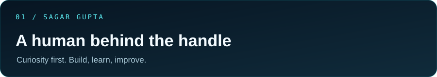
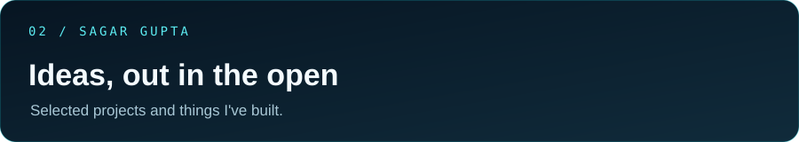
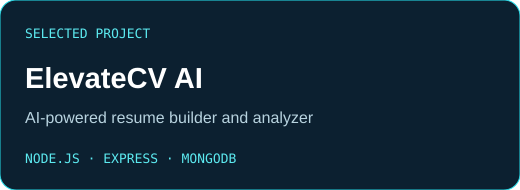
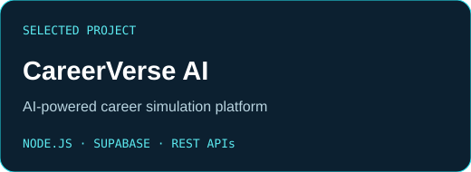
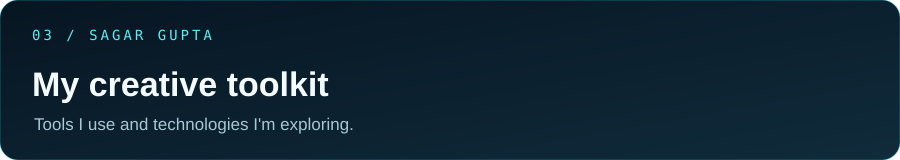
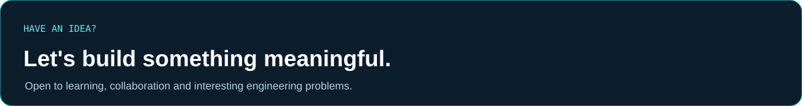

<!-- Sagar Gupta | GitHub Profile README -->
<picture>
  <source media="(prefers-reduced-motion: reduce) and (max-width: 600px)" srcset="./assets/hero-mobile.svg" />
  <source media="(prefers-reduced-motion: reduce)" srcset="./assets/hero.svg" />
  <source media="(max-width: 600px)" srcset="./assets/hero-mobile.svg" />
  
</picture>

 

  
  
  
  

 

<picture><source media="(max-width: 600px)" srcset="./assets/section-01-mobile.svg" /></picture>

 

**Hey, I'm Sagar.** I'm a Computer Science student, software developer and open-source contributor who enjoys understanding how things work under the hood.

I like turning ideas into working software — exploring **backend engineering, full-stack development, databases and AI-powered applications**. I learn best by building, experimenting, debugging and improving things one step at a time.

My journey has also taken me into student technology communities and open source through **Google Student Ambassador 2026, Google Summer of Code 2026, and GirlScript Summer of Code 2026**. These are separate experiences, each contributing to how I learn and collaborate.

> **I build to understand. I experiment to learn. I keep improving to make things useful.**

 

<picture><source media="(max-width: 600px)" srcset="./assets/section-02-mobile.svg" /></picture>

 

A couple of projects from my building journey. Explore the repositories and live demos.

- **[ElevateCV AI — Live Demo](https://elevatecv-ai-rose.vercel.app/)**
- **[CareerVerse AI — Live Demo](https://career-verse-ai.vercel.app/)**

**[Explore all repositories ↗](https://github.com/SagarGupta-30?tab=repositories)**

 

<picture><source media="(max-width: 600px)" srcset="./assets/section-03-mobile.svg" /></picture>

 

Tools I use, technologies I've worked with, and areas I'm actively exploring.

| Area | Technologies & tools |
| :--- | :--- |
| **Programming** | JavaScript · Java · C · C++ · Python |
| **Frontend** | HTML · CSS · Bootstrap · Tailwind CSS · React · Next.js |
| **Backend** | Node.js · Express.js · REST API development |
| **Databases & ORM** | MongoDB · PostgreSQL · Supabase · Prisma |
| **AI & data** | RAG · Embeddings · AI-powered application development · AI agents and workflows |
| **Developer tools** | Git · GitHub · VS Code · Postman · Vercel |

**Currently exploring:** stronger backend engineering, scalable application design, AI-powered workflows and open-source development.

 

  
<b>Open-source journey & community</b>

   
   Google Student Ambassador 2026 — exploring Google's technology ecosystem and helping build awareness of its AI tools.
  
   Google Summer of Code 2026.    — open-source contribution experience, including a merged pull request for [AOSSIE-Org/BabyNest].                (https://github.com/AOSSIE-Org/BabyNest/pull/254#issuecomment-6101524316).
   
  GirlScript Summer of Code 2026** — Contributor and Ambassador; participated in the open-source community and contributed to [Nyay Setu].          (https://nyaysetu-lovat.vercel.app/).
  
   
  Google Summer of Code and GirlScript Summer of Code are two distinct programs.

 

  
<b>A little motion from my contribution history 🐍</b>

   
  <picture>
    <source media="(prefers-color-scheme: dark)" srcset="https://raw.githubusercontent.com/SagarGupta-30/SagarGupta-30/output/github-snake-dark.svg" />
    <source media="(prefers-color-scheme: light)" srcset="https://raw.githubusercontent.com/SagarGupta-30/SagarGupta-30/output/github-snake.svg" />
    
  </picture>
  This animation is generated by the GitHub Actions workflow in this repository. See `.github/workflows/snake.yml`.

 

<a href="mailto:guptasagar0130@gmail.com"><picture><source media="(max-width: 600px)" srcset="./assets/footer-mobile.svg" /></picture></a>

Build. Learn. Iterate. &nbsp; / &nbsp; <a href="https://github.com/SagarGupta-30">@SagarGupta-30</a>

